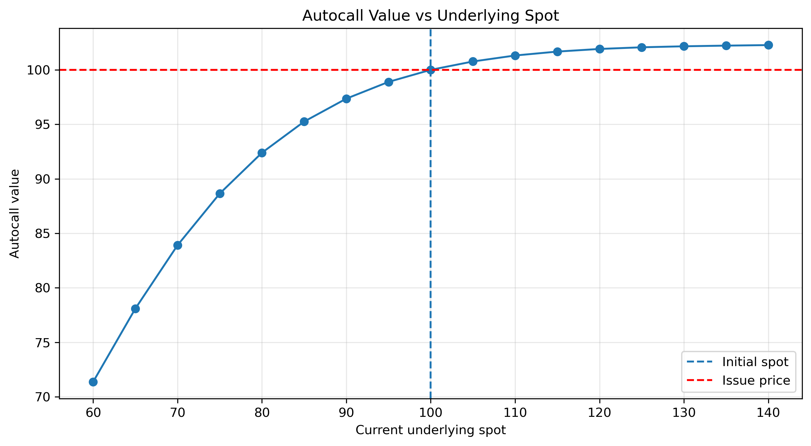
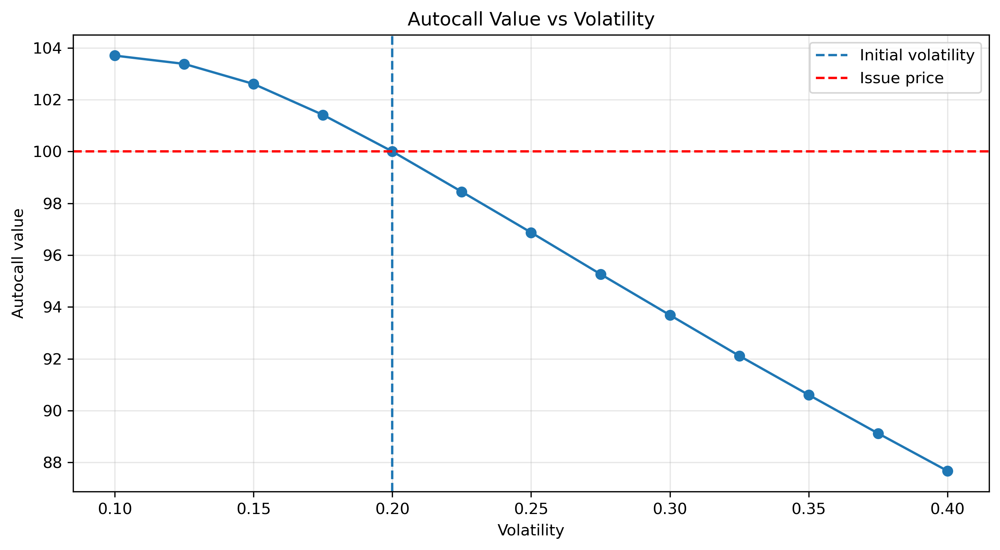
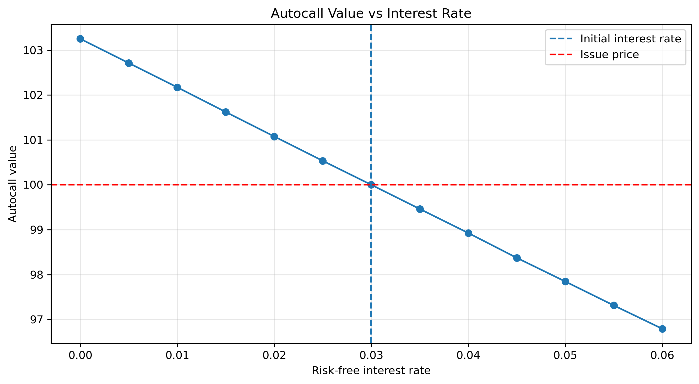
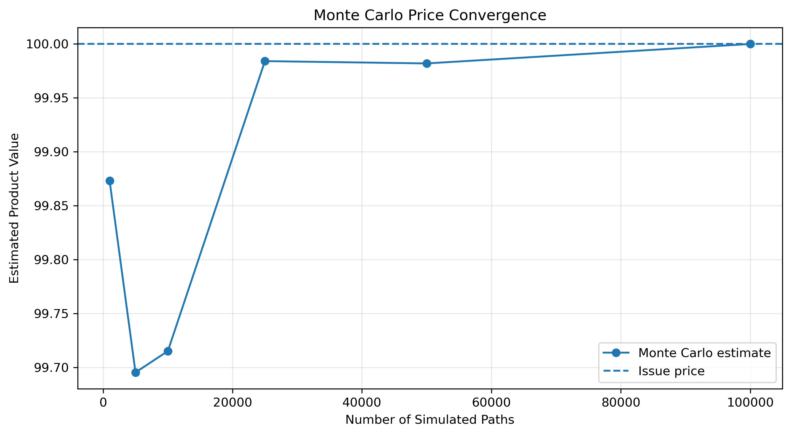
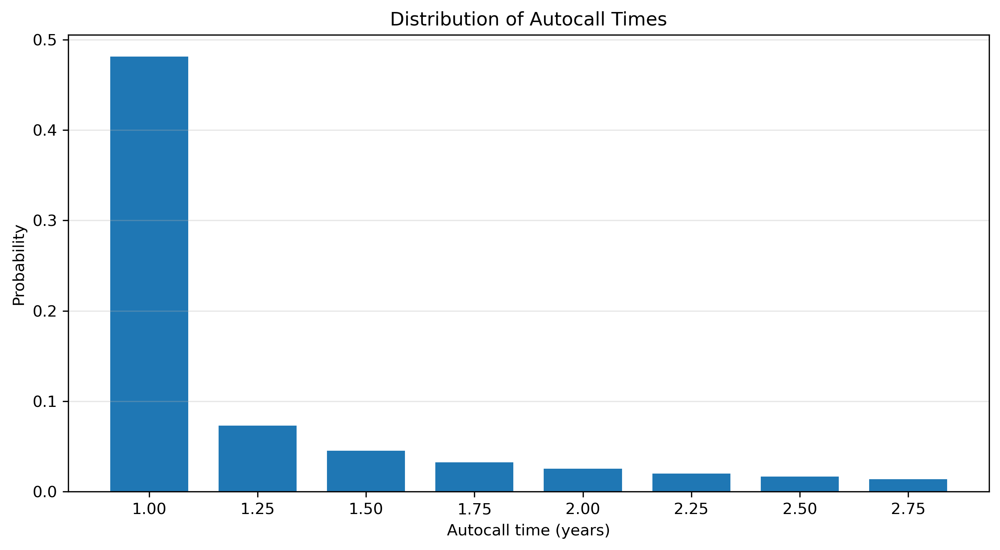

# Structuring and Pricing an Autocallable Note with Memory Coupons

This project develops a Python framework to structure, price and analyse a single-underlying autocallable note with conditional memory coupons and downside protection.

The project is developed from a structuring and trading perspective, with a focus on product mechanics, fair coupon calibration, Monte Carlo pricing and market risk sensitivities.

## Product Structure

The note has the following contractual features:

| Feature | Specification |
|---|---|
| Notional | 100 |
| Initial underlying level | 100 |
| Maximum maturity | 3 years |
| Observation frequency | Quarterly |
| Coupon type | Conditional memory coupon |
| Coupon barrier | 70% of initial level |
| Autocall level | 100% of initial level |
| Non-call period | 1 year |
| Downside protection barrier | 60% of initial level |
| Barrier observation | European |
| Settlement | Cash |
| Issue price | 100% of notional |

The coupon is not assumed exogenously. Instead, it is calibrated so that the theoretical value of the note is equal to its issue price.

## Pricing Methodology

The underlying is simulated under the risk-neutral measure using a geometric Brownian motion:

$$
dS_t = (r-q)S_tdt + \sigma S_tdW_t
$$

with constant risk-free rate, dividend yield and volatility.

For each simulated path, the model applies the contractual payoff rules, including:

- conditional coupon payments;
- accumulation of unpaid coupons through the memory feature;
- automatic early redemption;
- conditional downside protection at maturity.

Future cash flows are discounted to the valuation date and averaged across 100,000 Monte Carlo simulations.

The fair quarterly coupon is determined by solving:

$$
V_0(c^*) = 100
$$

where $c^*$ is the coupon rate that makes the theoretical value of the note equal to its issue price.

## Key Results

Under the initial market assumptions:

| Metric | Result |
|---|---:|
| Fair quarterly coupon | 1.34% |
| Simple annualized coupon | 5.37% |
| Early autocall probability | 70.73% |
| Probability of reaching maturity | 29.27% |
| Probability of principal loss | 7.16% |
| Probability of principal loss given maturity | 24.45% |
| Average principal loss given loss | 48.58% |

The outcome probabilities are generated under the risk-neutral pricing measure and should be interpreted as model-implied probabilities rather than forecasts of real-world frequencies.

## Risk Analysis

The calibrated product is repriced under instantaneous changes in the main market variables while contractual terms remain fixed.

Local finite-difference sensitivities around the initial market conditions are:

| Risk Measure | Value |
|---|---:|
| Delta | 0.1903 |
| Gamma | -0.0217 |
| Vega per 1 vol point | -0.6044 |
| Rho per 1 bp | -0.0101 |

These sensitivities correspond to the investor position and are local and state-dependent. Before hedging, the issuer has approximately the opposite exposures.

### Spot Sensitivity



### Volatility Sensitivity



### Interest Rate Sensitivity



## Monte Carlo Accuracy

The pricing framework uses 100,000 simulated paths.

At the calibrated fair coupon, the estimated Monte Carlo standard error is approximately **0.0405**, giving an approximate 95% confidence interval of:

$$
[99.9205,\ 100.0795]
$$

The final full-sample value of 100 is obtained by construction because the fair coupon is calibrated using the same Monte Carlo sample.



## Product Outcomes

The distribution of early-redemption dates illustrates how the autocall mechanism can significantly shorten the effective lifetime of the note relative to its three-year contractual maturity.



## Model Limitations

The framework is intentionally simplified to focus on the main economics of the structured product.

The main modelling assumptions include constant volatility, a constant risk-free rate and a constant dividend yield. The model also excludes issuer credit risk, funding costs, transaction costs and dynamic hedging.

A production-level implementation could incorporate an implied volatility surface, local or stochastic volatility, full interest-rate and dividend curves, issuer funding and credit, and dynamic hedging.

## Repository Structure

```text
autocall-snowball/
│
├── README.md
├── requirements.txt
├── .gitignore
│
├── notebooks/
│   └── autocall_snowball.ipynb
│
└── figures/
    ├── autocall_distribution.png
    ├── monte_carlo_convergence.png
    ├── rate_sensitivity.png
    ├── spot_sensitivity.png
    └── volatility_sensitivity.png
```

## Technologies

- Python
- NumPy
- Pandas
- SciPy
- Matplotlib
- Jupyter Notebook

## Disclaimer

This project is intended for educational and portfolio purposes. The model is a simplified representation of an autocallable structured product and should not be used for investment or trading decisions.